<div align="center">

  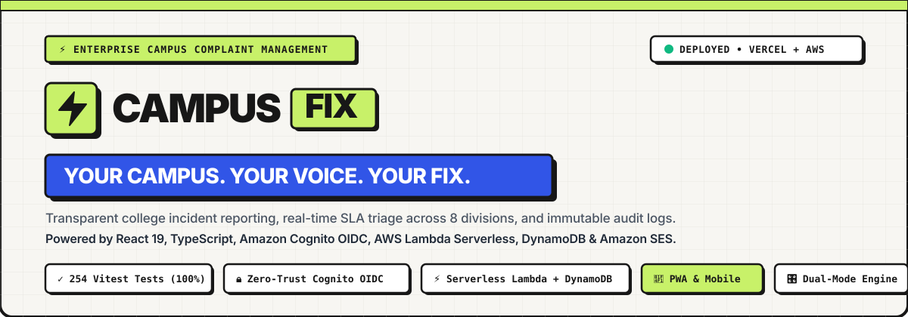

  <br />

  # ⚡ CAMPUSFIX
  ### Modern College Complaint Management & Incident Resolution Platform

  > **"Your Campus. Your Voice. Your Fix."**  
  > *A transparent, high-contrast incident management web application connecting college students, administrative teams, and facility divisions with auditable resolution workflows.*

  <br />

  [](https://campus-fix-ten-iota.vercel.app/)
  [-3155E7?style=for-the-badge&logo=vitest&logoColor=white)](tests/)
  [](https://react.dev/)
  [](https://www.typescriptlang.org/)
  [](https://aws.amazon.com/cognito/)
  [](backend/)
  [](https://aws.amazon.com/dynamodb/)
  [](https://aws.amazon.com/ses/)

  <br />

  [🌐 **Open Live Application**](https://campus-fix-ten-iota.vercel.app/) •
  [☁️ **Cloud Services Guide**](#-the-service-ecosystem-explained) •
  [🔄 **Core System Workflows**](#-end-to-end-service-workflows) •
  [📸 **Desktop Walkthrough**](#-desktop-interface-walkthrough) •
  [🏃 **Quickstart Guide**](#-developer-quickstart) •
  [🧪 **Test Suite (258 Tests)**](#-testing--quality-verification)

</div>

---

## 📌 What is CampusFix?

In traditional college campuses, grievance reporting is notoriously fragmented: students report broken lab equipment, electrical faults, or sanitation issues through paper registers, verbal complaints, or informal messages that get lost. Students never know if their issue was acknowledged, and facility managers lack operational metrics to track departmental turnaround times.

**CampusFix** solves this by establishing a **centralized, transparent, and auditable digital incident pipeline**:
- **Students** submit complaints in under 60 seconds, upload photo evidence, and track real-time resolution progress on an auditable 4-step timeline.
- **Campus Administrators** triage issues, assign ownership to 1 of 8 specialized campus divisions, and enforce Service Level Agreements (SLAs).
- **Automated Cloud Services** dispatch real-time email updates to students and escalate urgent safety hazards to technicians.

---

## 🌐 Live Production Deployment

The project is continuously deployed and accessible globally:

| Resource | URL | Operational Status |
|:---|:---|:---|
| **Production Web App** | [https://campus-fix-ten-iota.vercel.app/](https://campus-fix-ten-iota.vercel.app/) | 🟢 **Live & Deployed on Vercel** |
| **Backend Serverless API** | `https://<id>.lambda-url.ap-southeast-2.on.aws` | 🟢 **Active (AWS Sydney `ap-southeast-2`)** |

> [!TIP]
> **How to Test the Live Application**:
> - Visit [campus-fix-ten-iota.vercel.app](https://campus-fix-ten-iota.vercel.app/).
> - Click **Student Portal** to explore the student incident submission and audit tracking interface.
> - Click **Admin Operations** to view the triage console, SLA meters, and analytics suite.
> - In demo mode, preset accounts (*Rohan Sharma* for student, *Dr. Aris Thorne* for administrator) allow instant evaluation.

---

## 📸 Desktop Interface Walkthrough

Every screen in CampusFix is built with a high-contrast **Neo-Brutalist design language** (2.5px solid borders, hard-offset shadows, and functional accent colors) optimized for high legibility on desktop displays.

### 1. Desktop Landing Platform & Real-Time Operations Console
The public landing page introduces students and faculty to the platform, featuring live incident indicators and fast portal access.

<div align="center">
  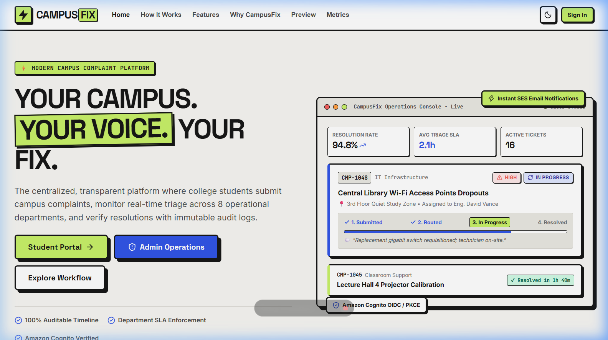
</div>

<br />

### 2. The 3-Step Incident Resolution Cycle
A step-by-step interactive workflow detailing student submission, administrative department routing, and verified technician resolution.

<div align="center">
  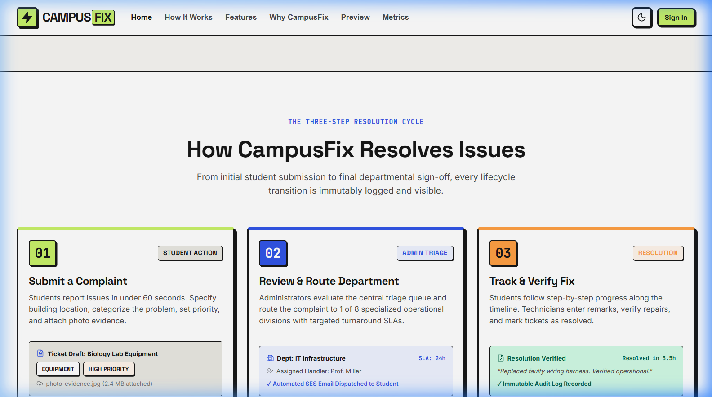
</div>

<br />

### 3. Role-Based Portals: Student vs. Administrator Previews
CampusFix provides dedicated views tailored for student tracking and administrative management.

<div align="center">

**Student View: Personal Complaint Status & KPI Summary**
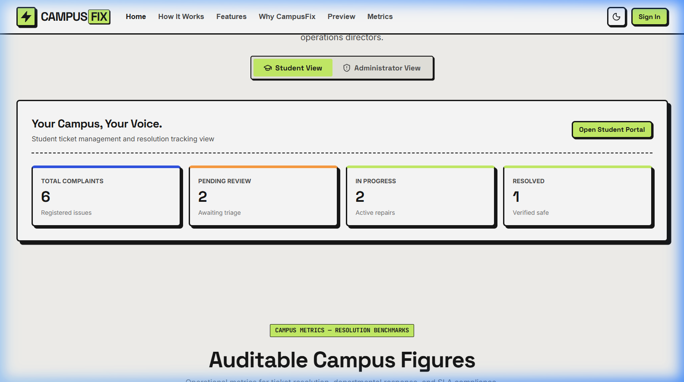

<br />

**Administrator View: Central Triage Queue & Critical Incident Routing**
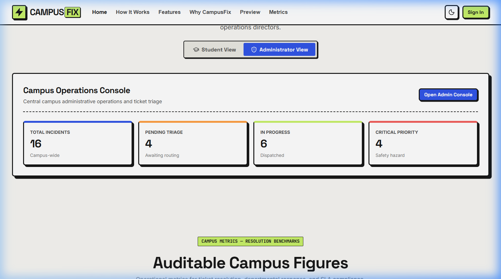

</div>

<br />

### 4. Amazon Cognito Single Sign-On (SSO) Portal
Enterprise authentication screen connecting university identity pools with OAuth 2.0 PKCE cryptographic tokens.

<div align="center">
  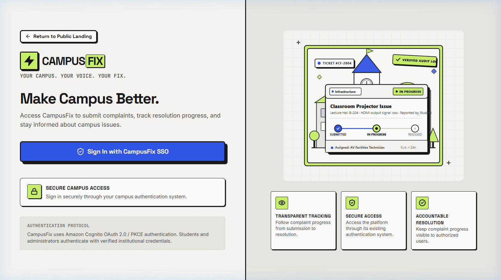
</div>

---

## ☁️ The Service Ecosystem Explained

If you are new to modern cloud architectures, understanding how each service works and why it was chosen makes the entire platform clear. CampusFix coordinates **7 specialized cloud and frontend services**:

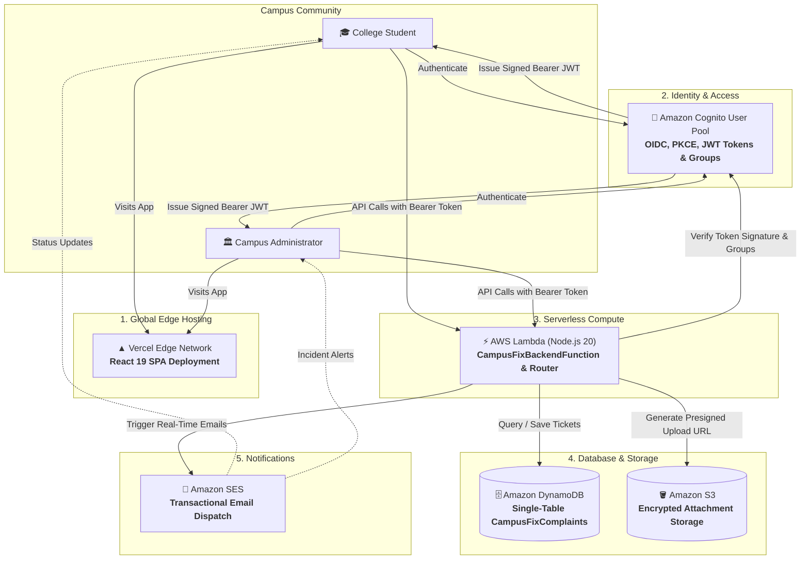

### Detailed Breakdown of Each Service

| # | Service Name | Role in CampusFix | Why We Use It |
|:---:|:---|:---|:---|
| **1** | **React 19 + Vite** | **Frontend Application** | Powers the interactive Single-Page Application (SPA) with instant routing, responsive Recharts data visualizations, and the custom Neo-Brutalist design token system. |
| **2** | **Vercel** | **Edge Deployment Network** | Delivers lightning-fast sub-second global loading of frontend assets with automated continuous deployment directly from GitHub. |
| **3** | **Amazon Cognito** | **User Authentication & RBAC** | Handles secure user login and role authorization using **OAuth 2.0 Authorization Code Flow with PKCE**. Divides users into strict groups (`Students` vs. `Administrators`) and issues cryptographically signed JWTs. |
| **4** | **AWS Lambda** | **Serverless Backend API** | Executes business logic on-demand without paying for idle virtual machines. When a student files a complaint or an admin updates a status, Lambda runs the code and shuts down immediately. |
| **5** | **Amazon DynamoDB** | **NoSQL Database** | Ultra-reliable database holding all complaint records and audit histories with single-digit millisecond latency. Uses **Single-Table Design** to query student queues and admin triage streams efficiently. |
| **6** | **Amazon SES** | **Transactional Email Service** | Automatically dispatches branded HTML email notifications to students when their tickets update and alerts campus technicians when emergencies occur. |
| **7** | **Amazon S3** | **Evidence Attachment Storage** | Secures uploaded incident photos and documents using temporary, encrypted presigned URLs, ensuring private academic data is never publicly exposed. |

---

## 🔄 End-to-End Service Workflows

Here is how data flows through these services during real-world campus scenarios:

### Workflow 1: Student Files a New Complaint

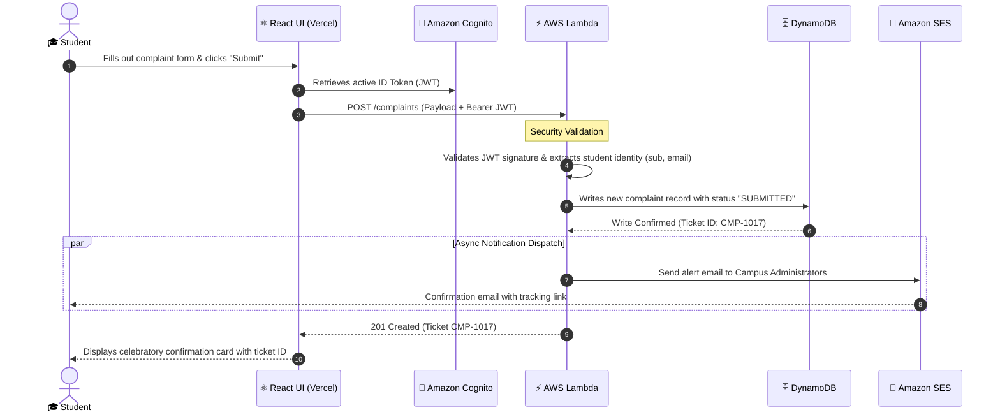

**Key Takeaways for Developers**:
- The student's ID and email are **never taken from frontend form inputs**—they are extracted directly from the verified cryptographic JWT header on the server, preventing identity spoofing.
- The SES email dispatch runs in a non-blocking background branch so students receive immediate UI confirmation without waiting for email delivery.

---

### Workflow 2: Administrator Triage & Department Routing

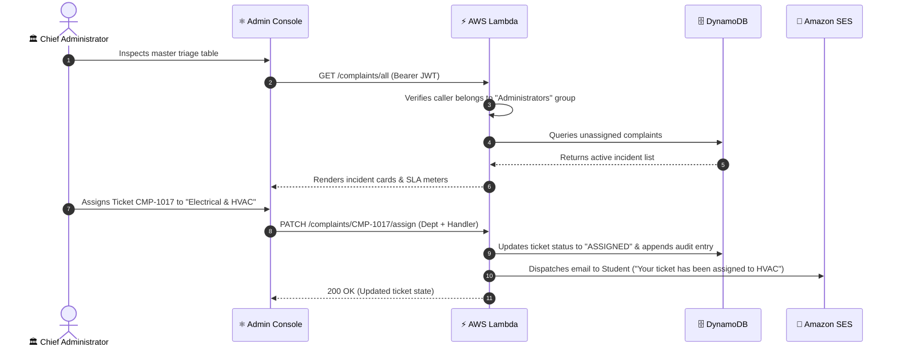

**Key Takeaways for Developers**:
- Only users verified in the Cognito `Administrators` group can access `/complaints/all` or assign departments. Any non-admin request is immediately rejected with a `403 Forbidden` response.
- Status changes strictly follow a business rules engine: tickets cannot skip intermediate steps, and every change permanently records the actor's name, role, and timestamp.

---

### Workflow 3: Technician Repair & Resolution Sign-Off

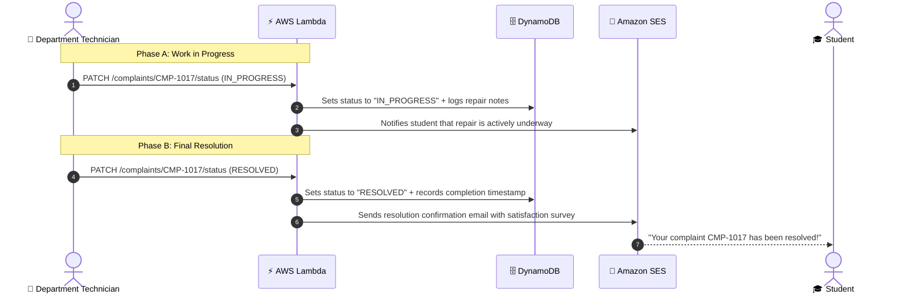

**Key Takeaways for Developers**:
- If a complaint must be rejected (e.g. invalid location, duplicate submission), the state machine mandates a **detailed rejection rationale** (minimum 10 characters). Rejection without a written reason is blocked by the system.

---

## 🚦 Complaint Lifecycle State Machine

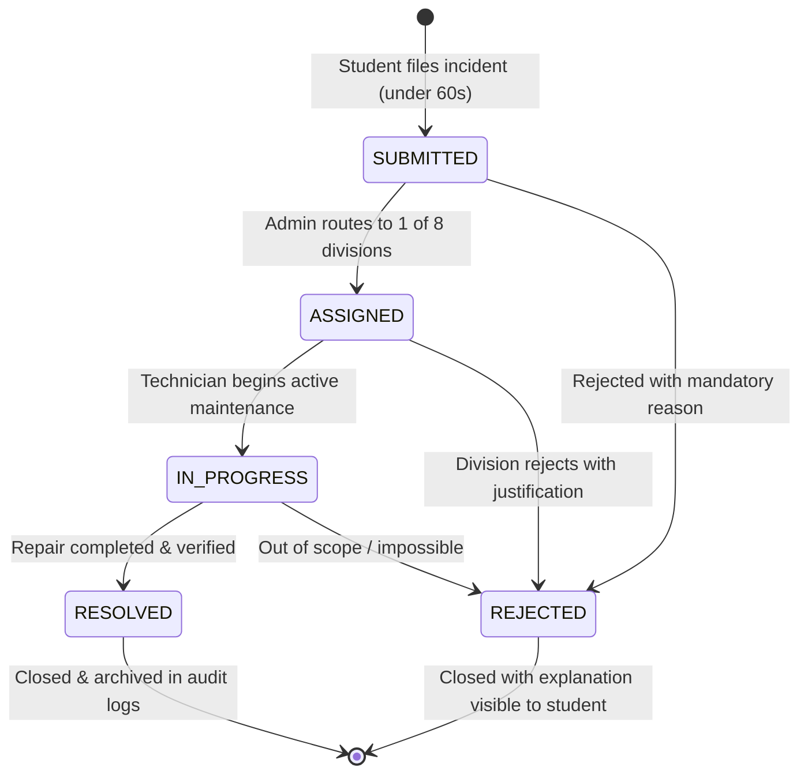

---

## 🏢 8 Operational Campus Divisions & SLA Standards

CampusFix routes incidents across 8 specialized academic and facility divisions with explicit turnaround clocks:

| Operational Division | Department Head | SLA Clock | Core Incident Responsibility |
|:---|:---|:---:|:---|
| **Information Technology** | Sarah Jenkins | `< 12 hrs` | Campus Wi-Fi, classroom projectors, computer labs, LMS portals |
| **Electrical & HVAC** | Dave Wilson | `< 24 hrs` | Power failure, AC units, lecture hall lighting, elevator circuits |
| **Plumbing & Water** | Frank Miller | `< 8 hrs` | Restroom pipe leaks, drinking water purifiers, drainage backups |
| **Civil Infrastructure** | Anita Desai | `< 72 hrs` | Broken desks/chairs, door hinges, broken windows, wall masonry |
| **Sanitation & Housekeeping** | Carlos Gomez | `< 4 hrs` | Waste disposal, restroom hygiene, chemical sanitization |
| **Hostel & Residential** | Priya Nair | `< 16 hrs` | Dorm room issues, common room amenities, laundry facilities |
| **Campus Security** | Capt. Viktor Vance | `< 2 hrs` | Security access badges, gate controls, perimeter illumination |
| **Library & Academic Services** | Elena Rostova | `< 24 hrs` | Study room bookings, noise disturbances, digital catalog kiosks |

---

## 🏃 Developer Quickstart

Get CampusFix running locally in less than 2 minutes.

### 1. Clone & Install
```bash
# Clone the repository
git clone https://github.com/Ranjitpatra26/CAMPUS-FIX.git
cd CAMPUS-FIX

# Install frontend dependencies
npm install

# (Optional) Install serverless backend dependencies
npm install --prefix backend
```

### 2. Configure Environment
Create your local environment file:
```bash
cp .env.example .env
```

CampusFix features a **Dual-Engine Architecture**. You can run immediately with mock data, or connect your AWS cloud services:

```env
# Mode A: Instant Mock / Demo Mode (No AWS credentials needed!)
VITE_ENABLE_MOCK_AUTH=true
VITE_MOCK_STORAGE_KEY=campusfix_mock_complaints_v1

# Mode B: Production Cloud Mode (Connects to AWS Cognito & Lambda)
# VITE_ENABLE_MOCK_AUTH=false
# VITE_COGNITO_USER_POOL_ID=ap-southeast-2_XXXXXXXXX
# VITE_COGNITO_CLIENT_ID=XXXXXXXXXXXXXXXXXXXXXXXXXX
# VITE_COGNITO_DOMAIN=your-domain.auth.ap-southeast-2.amazoncognito.com
# VITE_API_BASE_URL=https://<id>.lambda-url.ap-southeast-2.on.aws
```

### 3. Start Local Development Server
```bash
npm run dev
```
Open **`http://localhost:5173`** in your browser to view the application.

### 4. Build for Production
```bash
npm run build
```
Runs strict TypeScript compilation (`tsc -b`) and bundles client assets via Vite into `dist/`.

---

## 🧪 Testing & Quality Verification

CampusFix maintains a comprehensive automated test suite powered by **Vitest**, verifying authentication security, state machines, and data isolation:

```bash
npm test
```

### Test Suite Results: 258 Tests Passing (100% Pass Rate)

```
Test Files  19 passed (19)
     Tests  258 passed (258)
  Duration  3.31s

✓ tests/complaintRepository.test.ts      (16 tests)  - In-memory repository, CRUD, recovery from corrupted storage
✓ tests/apiComplaintRepository.test.ts   (17 tests)  - Cloud REST API adapter, JWT injection, network retry
✓ tests/userProfile.test.ts              (27 tests)  - User profile customizations, avatars, display names
✓ tests/callbackFlowAndNavigation.test.ts (5 tests)  - Cognito PKCE code exchange & automatic route redirect
✓ tests/productionAuth.test.ts           (14 tests)  - Dual-mode authentication switching & security guards
✓ tests/authFlowVerification.test.ts      (5 tests)  - Form validation & credential error handling
✓ tests/cognitoAuth.test.ts              (15 tests)  - OIDC PKCE redirect construction & claim parsing
✓ tests/responsiveFoundations.test.ts    (12 tests)  - Design tokens, touch target dimensions, viewports
✓ tests/loginPageRedesign.test.ts        (18 tests)  - Split-screen layout, accessibility & demo buttons
✓ tests/mobileResponsiveAndPwa.test.ts    (9 tests)  - PWA service worker, web manifest, bottom navigation
✓ tests/analyticsUtils.test.ts           (18 tests)  - Recharts calculations, department breakdown algorithms
✓ tests/exportReport.test.ts             (12 tests)  - CSV generation & executive print-to-PDF formatting
✓ tests/formValidation.test.ts           (10 tests)  - Client-side input length limits & file size restrictions
✓ tests/spaRoutingAndLogout.test.ts       (8 tests)  - Route guards & secure session clearance
✓ tests/authService.test.ts               (8 tests)  - Session storage resilience & demo role switching
✓ backend/tests/auth.test.ts              (5 tests)  - Cryptographic token verification & group authorization
✓ backend/tests/handler.test.ts          (26 tests)  - Zero-trust IDOR defense & endpoint security
✓ backend/tests/notifications.test.ts    (18 tests)  - Amazon SES email dispatch & sandbox fault tolerance
```

---

## 📁 Project Structure

```
complaint-managent/
├── docs/                               # Architecture blueprints, security audits & images
│   ├── images/                         # Widescreen desktop screenshots & vector banner
│   ├── aws-architecture.md             # AWS Cloud migration & DynamoDB single-table spec
│   ├── qa-report.md                    # Comprehensive test & QA verification audit
│   └── security-audit.md               # 17-point security verification report
├── backend/                            # Production AWS Lambda Serverless Microservice
│   ├── src/
│   │   ├── auth.ts                     # Cognito token parsing & group authorizer
│   │   ├── db.ts                       # DynamoDB single-table CRUD & GSI queries
│   │   ├── notifications.ts            # Amazon SES transactional email service
│   │   ├── router.ts                   # RESTful route dispatcher & error handler
│   │   └── types.ts                    # Backend domain interfaces
│   ├── tests/                          # Backend Vitest tests (Auth, Endpoints, SES)
│   ├── campusfix-lambda.zip            # Self-contained deployment bundle for AWS
│   └── README.md                       # Backend deployment manual
├── public/                             # Public static assets & PWA configuration
│   ├── campusfix-login-illustration.svg# Neo-Brutalist architectural vector illustration
│   ├── campus-landmark.svg             # Academic clock tower landscape illustration
│   ├── favicon.svg                     # Vector brand mark favicon
│   ├── manifest.webmanifest            # Progressive Web App manifest
│   └── sw.js                           # Offline caching service worker
├── src/                                # Frontend Single-Page Application (SPA)
│   ├── components/                     # Reusable modular UI components
│   │   ├── brand/BrandLogo.tsx         # Responsive Neo-Brutalist wordmark
│   │   ├── complaints/                 # Badges, timelines, tables & triage filters
│   │   ├── dashboard/                  # KPI cards & Recharts analytics visualizations
│   │   ├── forms/ComplaintForm.tsx     # Validated complaint submission form
│   │   ├── layout/                     # Navbar, Sidebar, BottomNav, MobileDrawer
│   │   └── ui/                         # Buttons, Inputs, Modals, Toasts
│   ├── context/                        # Global state providers (Auth, Notification, Theme)
│   ├── pages/                          # Application views (Student, Admin, Auth, Landing)
│   ├── services/                       # Data layer (Auth Adapters, Repositories, Mock Data)
│   ├── styles/                         # Neo-Brutalist CSS tokens & animations
│   ├── types/                          # TypeScript shared domain contracts
│   ├── utils/                          # CSV export, date formatting, user profile
│   └── App.tsx                         # Client-side router & route guard definitions
├── tests/                              # Frontend Vitest test suite (16 test files)
├── package.json                        # Frontend dependencies & test scripts
└── vite.config.ts                      # Vite build configuration & test setup
```

---

## 📄 License & Attribution

Distributed under the **MIT License**. See `LICENSE` for details.

Developed for collegiate communities striving for transparency and operational excellence.  
**Live Application**: [https://campus-fix-ten-iota.vercel.app/](https://campus-fix-ten-iota.vercel.app/)
