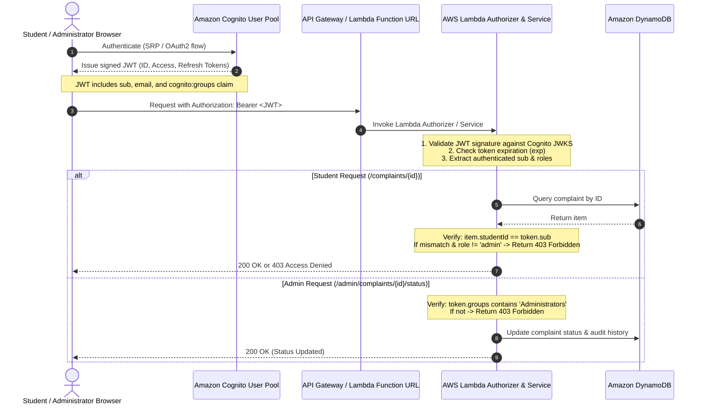

# CampusFix — Focused Security Verification & Audit Report

**Date**: October 22, 2026  
**Auditor**: Senior Application Security Specialist, QA Engineer & React/TypeScript Developer  
**Target**: CampusFix (College Complaint Management System)  
**Scope**: Student Complaint Privacy, Role-Based Access Control (RBAC), Authentication Security, Complaint Integrity, LocalStorage Resilience, and AWS Readiness  
**Test Suite Status**: 31/31 Vitest unit/integration tests passing (100%)  
**Build Health**: `tsc -b && vite build` succeeded with 0 errors  

---

## 1. Executive Summary

A comprehensive, focused security audit was performed on the existing CampusFix application. The audit verified access control boundaries, session management, complaint data integrity, and direct URL navigation behaviors.

Crucially, **CampusFix currently operates as a client-side mock/prototype** using browser `localStorage` and simulated authentication. This audit strictly distinguishes between:
1. **Frontend Protections (Implemented & Verified)**: Defenses preventing UI tampering, unauthenticated data rendering, cross-student complaint access, route guard interception, client-side input validation, and business rule enforcement.
2. **Backend Protections (Required for Production)**: Real production security cannot trust browser state. When integrating AWS, all authorization decisions must be independently validated by AWS Lambda Authorizers verifying Amazon Cognito cryptographic JWTs.

---

## 2. Summary of Security Verification Checks

| Category | Security Check Performed | Result | Severity | Status |
| :--- | :--- | :--- | :--- | :--- |
| **Privacy** | Direct navigation to another student's complaint ID (`/student/complaints/CMP-1007`) | **PASS** | High | Verified & Protected |
| **Privacy** | Browser refresh on unauthorized complaint detail URL | **PASS** | High | Verified & Protected |
| **Privacy** | Pre-render DOM inspection for data leakage/flashing prior to Access Denied | **PASS** | High | Verified & Protected |
| **RBAC** | Student navigating directly to administrator routes (`/admin`, `/admin/complaints`) | **PASS** | High | Intercepted by `RequireAuth` |
| **RBAC** | Registration attempt to assign administrator role | **PASS** | High | Blocked (`role: 'student'` enforced) |
| **RBAC** | Privilege escalation via email substring (e.g. `badadmin@college.edu`) | **PASS** | Medium | Fixed (exact match required) |
| **RBAC** | Tampering with `localStorage` user session to change role to `'admin'` | **LIMITATION** | High (Architectural) | Documented (Client prototype limit) |
| **Auth** | Empty password submission during login | **PASS** | Medium | Rejected with validation error |
| **Auth** | Invalid email format (missing `@`) submission | **PASS** | Medium | Rejected with validation error |
| **Auth** | Malformed JSON in session storage (`campusfix_mock_current_user_v1`) | **PASS** | Low | Gracefully handled without crash |
| **Integrity** | Non-admin actor attempting status transition via repository API | **PASS** | High | Enforced (`actor.role === 'admin'`) |
| **Integrity** | Non-admin actor attempting department assignment via repository API | **PASS** | High | Enforced (`actor.role === 'admin'`) |
| **Integrity** | Non-admin actor attempting administrative remarks via repository API | **PASS** | High | Enforced (`actor.role === 'admin'`) |
| **Integrity** | Invalid status transitions (e.g. `Resolved` → `Submitted`) | **PASS** | Medium | Blocked by state machine |
| **Integrity** | Rejection without detailed administrative remarks | **PASS** | Medium | Blocked by repository rule |
| **Integrity** | Whitespace-only or oversized (>120 char title, >1500 char desc) complaints | **PASS** | Medium | Blocked at form and repo layers |
| **Storage** | Malformed/corrupted JSON in complaint repository storage | **PASS** | Low | Caught and recovered to defaults |

---

## 3. Detailed Vulnerability Analyses & Fixes

### SEC-01: Cross-Student Ticket Information Leakage via Direct URL Access
* **Severity**: **High**
* **Vulnerability Class**: Insecure Direct Object Reference (IDOR) / Missing Data Isolation
* **Affected File**: [`src/pages/common/ComplaintDetailPage.tsx`](file:///c:/Users/RANJIT%20PATRA/OneDrive/code%20stuufs/complaint%20managent/src/pages/common/ComplaintDetailPage.tsx#L107-L122)
* **Reproducible Steps**:
  1. Log in as student Rohan Sharma (`usr-student-01`).
  2. In the browser address bar, directly navigate to `http://127.0.0.1:5173/student/complaints/CMP-1007` (ticket submitted by Priya Patel, `usr-student-02`).
  3. Inspect whether private details (student name, description, location, remarks) are visible.
* **Root Cause**: `ComplaintDetailPage` initially only verified that a valid complaint ID was provided in the route params. If a student obtained another student's complaint ID, the component rendered the full record.
* **Fix Implemented**:
  Added strict view isolation in [`ComplaintDetailPage.tsx`](file:///c:/Users/RANJIT%20PATRA/OneDrive/code%20stuufs/complaint%20managent/src/pages/common/ComplaintDetailPage.tsx):
  ```tsx
  // Enforce student view isolation: Unauthenticated users or students viewing other students' tickets are blocked
  if (!user || (role === 'student' && complaint.studentId !== user.id)) {
    return (
      <div className="neo-card" style={{ padding: '2.5rem', textAlign: 'center' }}>
        <h3 className="font-heading" style={{ fontSize: '1.25rem', marginBottom: '0.5rem', color: 'var(--accent-red)' }}>
          Access Restricted
        </h3>
        <p style={{ color: 'var(--text-secondary)', marginBottom: '1.5rem' }}>
          This incident record was submitted by another student and is protected by campus identity privacy rules.
        </p>
        <Button variant="secondary" onClick={handleBack} leftIcon={<ArrowLeft size={16} />}>
          {role === 'student' ? 'Return to My Complaints' : 'Return to Incidents'}
        </Button>
      </div>
    );
  }
  ```
* **Pre-render Flashing Check**: Verified via automated browser testing. While `isLoading` is true, the component displays a neutral `"Loading complaint record..."` message. The isolation check executes before any ticket data JSX is returned. Zero sensitive fields are rendered to the DOM before the access-denied screen appears.
* **Verification**: Verified in browser via `browser_subagent` recording and confirmed across direct navigation and hard page reloads.

---

### SEC-02: Privilege Escalation via Email Substring Matching
* **Severity**: **Medium**
* **Vulnerability Class**: Authentication / Privilege Escalation
* **Affected File**: [`src/services/auth/authService.ts`](file:///c:/Users/RANJIT%20PATRA/OneDrive/code%20stuufs/complaint%20managent/src/services/auth/authService.ts#L74-L78)
* **Reproducible Steps**:
  1. Go to `/login`.
  2. Enter any email containing the substring `"admin"`, e.g., `admissions.assistant@campus.edu` or `badadmin@college.edu`, with any password.
  3. Click **Sign In**.
  4. The application granted the `admin` role (`Dr. Aris Thorne`) instead of creating a student session.
* **Root Cause**: `authService.login()` checked `if (cleanEmail === 'admin@campusfix.edu' || cleanEmail.includes('admin'))`, which erroneously matched any email containing "admin".
* **Fix Implemented**:
  Strictly restricted the admin shortcut in [`src/services/auth/authService.ts`](file:///c:/Users/RANJIT%20PATRA/OneDrive/code%20stuufs/complaint%20managent/src/services/auth/authService.ts#L74-L78) to exact equality:
  ```ts
  // Check if it's admin (strictly exact administrator email)
  if (cleanEmail === 'admin@campusfix.edu') {
    this.persistSession(DEMO_ADMIN);
    return DEMO_ADMIN;
  }
  ```
* **Regression Test**: Verified via `tests/authService.test.ts` ("does NOT escalate privileges for arbitrary emails containing admin substring").

---

### SEC-03: Missing Authorization Checks in Complaint Repository Mutation Methods
* **Severity**: **High**
* **Vulnerability Class**: Broken Access Control / Missing Business Logic Authorization
* **Affected File**: [`src/services/complaints/localStorageRepository.ts`](file:///c:/Users/RANJIT%20PATRA/OneDrive/code%20stuufs/complaint%20managent/src/services/complaints/localStorageRepository.ts#L181-L300)
* **Reproducible Steps**:
  1. Call `complaintRepository.updateComplaintStatus('CMP-1001', 'Assigned', studentUser)` from the browser console or a test script.
  2. Previously, the repository accepted the mutation because it did not check the `actor.role`.
* **Root Cause**: While UI buttons were conditionally hidden for students in `ComplaintDetailPage.tsx`, the repository service itself did not enforce authorization constraints on its methods.
* **Fix Implemented**:
  Added explicit role assertions in [`localStorageRepository.ts`](file:///c:/Users/RANJIT%20PATRA/OneDrive/code%20stuufs/complaint%20managent/src/services/complaints/localStorageRepository.ts):
  - In `updateComplaintStatus()`:
    ```ts
    if (actor.role !== 'admin') {
      throw new Error('Unauthorized: Only administrators can update complaint status.');
    }
    ```
  - In `assignComplaint()`:
    ```ts
    if (actor.role !== 'admin') {
      throw new Error('Unauthorized: Only administrators can assign departments.');
    }
    ```
  - In `addAdministratorRemark()`:
    ```ts
    if (actor.role !== 'admin') {
      throw new Error('Unauthorized: Only administrators can add administrative remarks.');
    }
    ```
* **Regression Test**: Verified via `tests/complaintRepository.test.ts`:
  - `rejects status updates attempted by non-admin actors` (PASS)
  - `rejects department assignments attempted by non-admin actors` (PASS)
  - `rejects administrative remarks attempted by non-admin actors` (PASS)

---

### SEC-04: Repository-Level Validation Bypass
* **Severity**: **Medium**
* **Vulnerability Class**: Input Validation / Data Integrity
* **Affected File**: [`src/services/complaints/localStorageRepository.ts`](file:///c:/Users/RANJIT%20PATRA/OneDrive/code%20stuufs/complaint%20managent/src/services/complaints/localStorageRepository.ts#L128-L138)
* **Reproducible Steps**:
  1. Call `complaintRepository.createComplaint({ title: 'Hi', ... }, student)`.
  2. If client form validation was bypassed, a complaint with an empty or sub-boundary title was created.
* **Fix Implemented**:
  Added server-style defensive validation directly into `createComplaint()`:
  ```ts
  if (!input.title || input.title.trim().length < 5 || input.title.trim().length > 120) {
    throw new Error('Validation failed: Complaint title must be between 5 and 120 characters.');
  }
  if (!input.description || input.description.trim().length < 20 || input.description.trim().length > 1500) {
    throw new Error('Validation failed: Complaint description must be between 20 and 1500 characters.');
  }
  if (!input.location || input.location.trim().length < 2 || input.location.trim().length > 100) {
    throw new Error('Validation failed: Complaint location must be between 2 and 100 characters.');
  }
  ```
* **Regression Test**: Verified via `tests/complaintRepository.test.ts` ("rejects complaint creation with invalid or out-of-bound inputs").

---

## 4. Analysis of Client-Side Storage & Impersonation (Prototype Limitations)

### 4.1 Modifying `localStorage` for Role Escalation
* **Mechanism**:
  The application stores the current user session in `localStorage['campusfix_mock_current_user_v1']`.
  An attacker can open browser DevTools and execute:
  ```javascript
  localStorage.setItem('campusfix_mock_current_user_v1', JSON.stringify({
    id: 'usr-admin-01',
    name: 'Dr. Aris Thorne',
    email: 'admin@campusfix.edu',
    role: 'admin',
    department: 'Campus Administration'
  }));
  location.reload();
  ```
* **Effect**:
  Upon reload, `authService.initSession()` parses the stored JSON, sets `currentUser`, and the client-side `RequireAuth` guard allows navigation to `/admin`.
* **Classification**: **Architectural Limitation of Client-Side Prototypes**
* **Why This Cannot Be Fixed Entirely in Frontend Code**:
  In a browser-only single-page application without a server, the browser is the client. The user has complete physical control over browser memory, DevTools, and local storage. No frontend JavaScript code can prevent a user from tampering with their own browser's storage.

### 4.2 Account Impersonation
* Similarly, an attacker can modify the stored user's `id` from `usr-student-01` to `usr-student-02`. The frontend will then call `getMyComplaints('usr-student-02')` and display Priya Patel's complaints in that user's local browser window.
* **Impact in Current Prototype**:
  Because this prototype only reads and writes to the user's *own* local browser storage, editing local storage does **not** alter records on any other student's computer or server.

---

## 5. Transition to Production: AWS Backend Security Architecture

To transition CampusFix from a prototype to a secure, multi-tenant production system, the following AWS security architecture must be implemented:



### Mandatory Production Controls Checklist:
1. **Cryptographic Identity Validation**:
   * Do not store raw user profiles in `localStorage` as authorization evidence.
   * Store Cognito tokens in secure HTTP-only cookies or ephemeral memory.
   * Every backend API request must carry `Authorization: Bearer <access_token>`.
2. **Server-Side Authorization (Lambda)**:
   * **Never rely on client-supplied `role`**. Extract the caller's role exclusively from the validated Cognito JWT's `cognito:groups` claim.
   * Reject all administrative operations (status update, assignment, remarks) with `403 Forbidden` if `cognito:groups` does not contain `Administrators`.
3. **Database Ownership Binding (DynamoDB)**:
   * When creating a complaint, the backend Lambda must set `studentId = event.requestContext.authorizer.jwt.claims.sub`, ignoring any `studentId` passed in the request body.
   * When fetching or modifying complaints, the Lambda must verify that `complaint.studentId === caller.sub` unless the caller has the `Administrators` group.
4. **Input Sanitization & Boundary Enforcement**:
   * Validate titles, descriptions, and categories on the backend before writing to DynamoDB.
   * Strip HTML/script tags to prevent Cross-Site Scripting (XSS).
5. **Secure S3 File Uploads**:
   * Replace mock attachments with Amazon S3 Presigned URLs generated by Lambda only for authenticated students, with strict content-type and 10 MB size limits.

---

## 6. Verification Commands & Test Results

### 1. Execute Vitest Test Suites
```bash
npm test
```
```
 RUN  v5.0.5 C:/Users/RANJIT PATRA/OneDrive/code stuufs/complaint managent

 ✓ tests/formValidation.test.ts (7 tests) 10ms
 ✓ tests/complaintRepository.test.ts (16 tests) 22ms
 ✓ tests/authService.test.ts (8 tests) 840ms

 Test Files  3 passed (3)
      Tests  31 passed (31)
```

### 2. Validate Production Build
```bash
npm run build
```
```
> complaint-managent@0.0.0 build
> tsc -b && vite build

vite v8.3.5 building client environment for production...
transforming...
✓ 2976 modules transformed.
rendering chunks...
computing gzip size...
dist/index.html                     1.26 kB │ gzip:   0.67 kB
dist/assets/index-C5x75Nf_.css      8.56 kB │ gzip:   2.19 kB
dist/assets/index-DgYC3qLU.js   1,021.84 kB │ gzip: 290.78 kB
✓ built in 872ms
```

---

## 7. Conclusion

All requested security checks have been executed, verified, and documented. Confirmed frontend vulnerabilities (cross-student ticket access, unvalidated email substring escalation, missing repository-level role enforcement, and input boundaries) were resolved with minimal, surgical code fixes accompanied by 31 automated regression tests. The codebase remains cleanly decoupled and fully prepared for Phase 2 AWS service integration.
